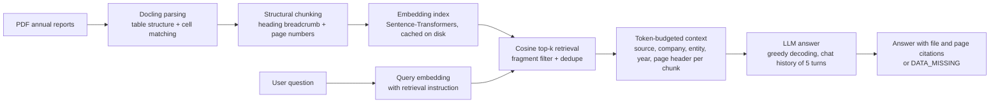

# finRAG: Financial RAG over Automotive Annual Reports

A retrieval-augmented question-answering assistant for annual reports of car manufacturers (BMW, Ford, Tesla). Ask a question in plain English; finRAG retrieves the relevant passages from the reports, answers **only from that evidence**, and cites the source file and page, or says `DATA_MISSING` when the documents do not contain the answer.

It runs fully locally on open models (Hugging Face `transformers` + `sentence-transformers`); no external API is called.

## Task

Analysis of annual reports within the automotive sector:

- extract key financial metrics (revenue, profit, growth figures),
- run comparative analyses across different car companies,
- stay grounded in the source documents and refuse when evidence is missing.

## How it works



1. **Parsing.** [Docling](https://github.com/docling-project/docling) converts each PDF. Table structure and cell matching are enabled so financial tables survive as rows and columns. OCR is off because the reports are vector PDFs.
2. **Chunking.** Docling's `HierarchicalChunker` splits by document structure. Each chunk keeps its heading path (prepended to the text), page numbers, company, report year and a deterministic chunk id. Tables are serialised as cell statements, e.g. `Group revenues, 2021 = 111,239.`
3. **Indexing.** Chunks are embedded once and cached (`embeddings.npy`), so later runs start quickly. The chunk cache is shared across embedding models.
4. **Retrieval.** The query is embedded with the model's retrieval instruction, then ranked by cosine similarity. Very short fragments (cover text, bare headings, link lines) and duplicate chunks are skipped, so they cannot take up top-k slots.
5. **Context building.** Chunks are added in rank order until the token budget is used. Whole chunks are kept or dropped, never cut. Each block is labelled with source file, company, reporting entity, report year and page.
6. **Generation.** A local LLM answers with greedy decoding (`do_sample=False`), so identical inputs give identical answers. The system prompt enforces the rules below.

### Answering rules (system prompt)

- Use only the supplied context; no outside facts.
- Keep company, period, currency, units, metric and sign together with every figure; do not mix up revenue, operating income, net income and adjusted EBIT.
- Distinguish group figures from subsidiary figures (the context block names the reporting entity).
- Cite as `[File.pdf, p. N]`.
- Compare companies and periods separately; if only part of a question is supported, answer that part and state what is unavailable.
- No arithmetic unless asked (then show the formula and inputs).
- If the context has no relevant evidence, reply exactly `DATA_MISSING`.

## Dataset

```bash
bash download_auto_financials.sh /path/to/desired_dataset_directory
```

## Setup

```bash
conda create -n py312 python=3.12 -y
conda activate py312
pip install -r requirements.txt
```

Models are downloaded from Hugging Face on first use. If a model needs authentication, set `HUGGINGFACE_TOKEN` in your environment. Model and index caches go to the directory configured in `cache_directory` at the top of `finrag.py`, or to the current directory by default.

## Run

Default (small embedding + LLM, suitable for a laptop with a small GPU):

```bash
python finrag.py -d /path/to/desired_dataset_directory
```

Larger models (HPC / powerful GPU):

```bash
python finrag.py -d /path/to/desired_dataset_directory -emb "Qwen/Qwen3-Embedding-8B" -llm "Qwen/Qwen3.8-27B" -v
```

`Octen/Octen-Embedding-8B` can be used as the embedding model in the same way.

The first run parses all PDFs and builds the index, which takes a while. Later runs load the caches. Type `exit` to quit.

| Option | Default | Meaning |
|---|---|---|
| `-llm`, `--llm_model` | `Qwen/Qwen3.5-0.8B` | generator model |
| `-emb`, `--embedding_model` | `Qwen/Qwen3-Embedding-0.6B` | retrieval embedder |
| `-bs`, `--batch_size` | `8` | embedding batch size |
| `--top_k` | `8` | chunks retrieved per question |
| `--max_seq_len` | `8192` | LLM context window (tokens) |
| `--max_new_tokens` | `1024` | maximum answer length |
| `--load_in_4bit` | off | 4-bit quantised LLM (less GPU memory) |
| `--rebuild_index` | off | recompute embeddings |
| `-v`, `--verbose` | off | print retrieved chunks, scores and chunk lengths |

## Example questions

The chat keeps the last 5 turns, so follow-ups work. Questions used to exercise the pipeline:

**Single facts**
- What was BMW's total revenue in 2023?
- How much revenue did Tesla generate in 2023?
- Ford's revenue 2020
- How about BMW's total revenue in 2020? if available, was it higher than Ford's?
- What was BMW's profit before tax in 2021?
- Which Tesla product is currently in the development stage?

**Comparisons and trends**
- Compare the 2021 revenue of BMW and Tesla.
- Between Tesla and Ford, which company achieved higher profits in 2022?
- Provide a summary of revenue figures for Tesla, BMW, and Ford over the past three years.
- Summarize the revenue growth of Tesla from 2021 to 2023.
- What were the growth trends for BMW's financial performance from 2020 to 2023?

**Explanatory**
- What key economic factors influenced Ford's performance in 2021?
- Why did Ford report a net loss in 2022 despite strong automotive sales?
- What caused the massive drop in Tesla's effective tax rate in 2023?

**Table-heavy**
- What were Tesla's revenues from the 'Energy generation and storage' segment in 2021, 2022, and 2023?
- Break down the $12.17 billion of special items expenses Ford recorded in 2022.

**Follow-ups (memory)**
- What raw materials is Ford dependent on for EV batteries?  
- Does Tesla face the same supply chain risks for those materials? 
- What about BMW?

**Should be refused (`DATA_MISSING`)**
- How many vehicles did Rivian deliver in 2022?
- Tesla's stock price on December 31, 2023
- How did the central bank's 0.5% interest rate hike affect Ford's F-150 Lightning sales?
- Did the new climate bill passed by Congress impact BMW's NEUE KLASSE platform?

Some questions are also expected to return `DATA_MISSING` or a partial answer because the corpus does not contain the figure, for example BMW group figures before 2021 or for 2022 and 2023 (see notes below).

## Known limitations

- **Data coverage.** The BMW 2022 and 2023 files are reports of BMW Finance N.V. (a subsidiary), not the BMW Group. Chunks are tagged with their reporting entity so answers say so instead of presenting subsidiary figures as group-wide. Only Tesla 2022/2023, Ford 2021 to 2023 and BMW 2021 are group-level. The corpus covers automotive companies only, so cross-sector comparisons are out of scope.
- **Very large table chunks.** A key-figures table that is chunked as a single multi-thousand-character block gets one diluted embedding and can rank far below short, topical chunks. Row-aware or size-capped table chunking is the main retrieval improvement still open.
- **Follow-up retrieval.** Chat history is passed to the LLM, but retrieval uses only the current question, so a follow-up that omits the company or year can retrieve poorly. Rewriting follow-ups into standalone queries would address this.
- **Model size matters.** Small models may ignore the citation rule or over-trust weak context; the larger models follow the rules more reliably.
- **Cache keys.** The chunk cache is keyed on the data directory and the embedding index on the PDF files and embedding model. If you change the chunker, delete the cached chunks and use `--rebuild_index`.